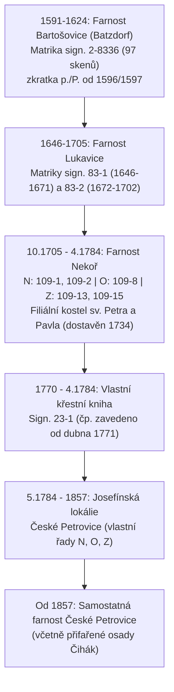

# Badatelský průvodce pro archivní výzkum obce České Petrovice

Praktická příručka pro navazující genealogický, místopisný a historický výzkum v **Českých Petrovicích** (*Böhmisch Petersdorf*). Shromažďuje ověřené permalinky, posloupnost farní správy, návod ke skriptům projektu, paleografický slovníček z přečtených matrik a pravidla pro vyloučení homonym.

---

## 1. Správní a farní posloupnost (kdy a kde hledat)

### 1.1 Vývoj farní příslušnosti



### 1.2 Matriční knihy v SOA Hradec Králové (Portál ARON)

| Sign. | Poř. č. | Obsah | Rozsah let | Původce | Skenů | Permalink ARON |
|---|---|---|---|---|---|---|
| `2-8336` | 60 | NOZ (`N 1597–1622`, `O 1611–1624`, `Z 1591–1618`) | 1591–1624 | FÚ Bartošovice | 97 | [8dcb1638](https://aron.vychodoceskearchivy.cz/apu/8dcb1638-0a4e-412c-a4de-64f58bdb7d1b) `[inv][doc]` |
| `83-1` | 5983 | NOZ | 1646–1671 | FÚ Lukavice | 114 | [8892a7da](https://aron.vychodoceskearchivy.cz/apu/8892a7da-a31a-4a18-a59f-2df1b606c5be) `[inv]` |
| `83-2` | 5984 | NOZ | 1672–1702 | FÚ Lukavice | 281 | [5cc6920c](https://aron.vychodoceskearchivy.cz/apu/5cc6920c-e18d-4dd6-80c2-4ff282d9eadc) `[inv]` |
| `109-1` | 7735 | N | 10.1705–9.1753 | FÚ Nekoř | 213 | [fd865aa0](https://aron.vychodoceskearchivy.cz/apu/fd865aa0-64b3-40ab-b855-2d914eb6e360) `[inv][doc]` |
| `109-2` | 7736 | N | 1753–1784 | FÚ Nekoř | 205 | [77b1c8ff](https://aron.vychodoceskearchivy.cz/apu/77b1c8ff-f67b-4d67-8a1a-0c175eeb84a2) `[inv]` |
| `109-8` | 7750 | O | 11.1705–2.1784 | FÚ Nekoř | 131 | [502a213a](https://aron.vychodoceskearchivy.cz/apu/502a213a-c42d-4051-8ce1-bdefc605205d) `[inv]` |
| `109-13` | 7763 | Z | 10.1705–5.1754 | FÚ Nekoř | 74 | [333292f4](https://aron.vychodoceskearchivy.cz/apu/333292f4-79b2-4792-8a92-7e2b7d9db54a) `[inv]` |
| `109-15` | 7765 | Z | 6.1772–4.1784 | FÚ Nekoř | 63 | [00dbff1c](https://aron.vychodoceskearchivy.cz/apu/00dbff1c-4174-401d-bad3-06f4ca332fa5) `[inv]` |
| `23-1` | 1436 | N, index N | 1770–4.1784 | FÚ České Petrovice | 40 | [1fe9c209](https://aron.vychodoceskearchivy.cz/apu/1fe9c209-25bf-47d8-99b3-22adea3d960c) `[inv][doc]` |
| `23-2` | 1437 | N | 5.1784–1816 | FÚ České Petrovice | 96 | [17cdcc87](https://aron.vychodoceskearchivy.cz/apu/17cdcc87-0319-4f6b-8b19-5000a5a3d0b3) `[inv]` |
| `23-3` | 1438 | N | 1817–1838 | FÚ České Petrovice | 100 | [7c2f7160](https://aron.vychodoceskearchivy.cz/apu/7c2f7160-7464-414c-9122-2114fdebfb6a) `[inv]` |
| `23-3310` | 1439 | N | 1839–1871 | FÚ České Petrovice | 243 | [6a165923](https://aron.vychodoceskearchivy.cz/apu/6a165923-1386-43be-961f-f11057d5ee3d) `[inv]` |
| `23-6333` | 1440 | N | 1872–1909 | FÚ České Petrovice | 187 | [7e80add9](https://aron.vychodoceskearchivy.cz/apu/7e80add9-89ec-4014-ab66-eb594b7a3247) `[inv]` |
| `23-4` | 1442 | O, index O | 11.1783–1844 | FÚ České Petrovice | 84 | [23efb07e](https://aron.vychodoceskearchivy.cz/apu/23efb07e-33ab-4ad8-b090-d8c4872caa94) `[inv]` |
| `23-6334` | 1443 | O | 1845–1919 | FÚ České Petrovice | 140 | [1f59fa32](https://aron.vychodoceskearchivy.cz/apu/1f59fa32-e5b6-45ae-9230-e48356a6ed6f) `[inv][doc]` |
| `23-5` | 1446 | Z, index Z | 11.1783–1844 | FÚ České Petrovice | 108 | [cb9cbdda](https://aron.vychodoceskearchivy.cz/apu/cb9cbdda-5e69-49d4-a2db-62e9b3987aae) `[inv][doc]` |
| `23-8990` | 1447 | Z, index Z (`II.`) | 1845–1942 | FÚ České Petrovice | 184 | [9cbebc69](https://aron.vychodoceskearchivy.cz/apu/9cbebc69-9e44-4482-8bbd-7e3d4cfe6a9c) `[inv][doc]` |
| `23-3317` | 1450 | index NOZ | 1783–1909 | FÚ České Petrovice | 149 | [a4a6c559](https://aron.vychodoceskearchivy.cz/apu/a4a6c559-fb20-4edb-b346-3fe3f250a44f) `[inv][doc]` |
| `6376` *(civ.)* | 2379 | NOZ civilní + ohlášky | 1894–1924 | OÚ Žamberk | 83 | [a863ff07](https://aron.vychodoceskearchivy.cz/apu/a863ff07-39ab-4fa9-806d-3f803a35b72d) `[inv][doc]` |
| `8272` *(civ.)* | 2381 | O civilní + ohlášky | 1923–1935 | OÚ Žamberk | 273 | [4ea680df](https://aron.vychodoceskearchivy.cz/apu/4ea680df-ad99-48b9-adbc-0a244f641f6d) `[inv][doc]` |

---

## 2. Sčítací operáty v SOkA Ústí nad Orlicí (fond Okresní úřad Žamberk)

| Rok | Inv. č. | Karton / uložení | Skenů | Permalink ARON | Poznámka |
|---|---|---|---|---|---|
| **1869** (sv. 1) | — | 1 karton AP 94 | 139 | [197cb94c](https://aron.vychodoceskearchivy.cz/apu/197cb94c-11c1-46db-958e-17538da057dc) `[inv][doc]` | Začíná `čp. 1` (snímek 2: *Umlauf Emanuel*), vč. příloh křestních listů |
| **1869** (sv. 2) | — | 2 karton AP 94 | 298 | [53fdd5ce](https://aron.vychodoceskearchivy.cz/apu/53fdd5ce-657b-4c09-a49d-4a5b17401057) `[inv][doc]` | Navazující domy z konce roku 1869 (`čp. 51–156`) |
| **1880** | 101 | 32 karton AP 94 | 424 | [2160547c](https://aron.vychodoceskearchivy.cz/apu/2160547c-5880-4444-b4ea-66af44ece0b7) `[inv]` | Obsahuje též souhrnnou rubriku obcovací řeči |
| **1890** | 209 | 69 karton AP 94 | 431 | [d1817bb5](https://aron.vychodoceskearchivy.cz/apu/d1817bb5-927a-42ec-b38e-ca5b7509cc5b) `[inv]` | Nejlidnatější předpoklesové sčítání v obci (`876` obyv.) |
| **1900** | 315 | 130 karton AP 94 | 353 | [649d7dba](https://aron.vychodoceskearchivy.cz/apu/649d7dba-1d81-4216-8ba3-f6d8e298c8f9) `[inv]` | Pokles na `657` obyv. |
| **1910 (`po`)** | 529 | 260 karton AP 94 | 11 | [01a84c3a](https://aron.vychodoceskearchivy.cz/apu/01a84c3a-5bb8-407e-965f-59ab75ff1a6e) `[inv][doc]` | Pouze souhrnný přehled obyvatelstva (`čp. 1–160` po řádcích) |
| **1910 (`pz`)** | 607 | 265 karton AP 94 | 8 | [0c1f8359](https://aron.vychodoceskearchivy.cz/apu/0c1f8359-afa0-4db0-aa04-6ce26478596c) `[inv][doc]` | Pouze přehled užitkového zvířectva |
| **1921** | 970 | 311 karton AP 75 | 286 | [f60944b0](https://aron.vychodoceskearchivy.cz/apu/f60944b0-189c-4af2-a4c9-705055a84f4e) `[inv][doc]` | Liché snímky (`1, 3, ..., 285`) obsahují rubriky `1–8` přední strany archů |

---

## 2a. Gruntovní a pozemkové knihy (tři chronologické vrstvy)

Pro České Petrovice **nejsou** gruntovní ani pozemkové knihy v portálu ARON SOA Hradec Králové zatím zdigitalizovány (`PUBLISHED: 0` `[inv]`). Bádání se dělí do tří navazujících institucí podle období:

| Časový horizont | Typ pramenů | Příslušný fond a instituce | Stav a postup přístupu |
|---|---|---|---|
| **Do pol. 19. stol.** *(přesahy do ~1880)* | Staré **gruntovní a purkrechtní knihy** poddanských usedlostí panství Kyšperk | **SOA Hradec Králové – AO Zámrsk**: *Velkostatek Kyšperk (Letohrad)* (`1568–1959`, ARON [362bf1b5](https://aron.vychodoceskearchivy.cz/apu/362bf1b5-fc43-4de1-aaa0-b112e83a856d)) a *Sbírka pozemkových knih Východočeského kraje* (ARON [09000192](https://aron.vychodoceskearchivy.cz/apu/09000192-0000-4000-8000-000225200010)) | Online nedostupné (`PUBLISHED: 0`); prezenční studium v badatelně Zámrsku dle inventáře (částečné východočeské mikrofilmy lze též ověřit v katalogu *FamilySearch – Czech Republic, Land Records, 1450–1889*). |
| **1850 – pol. 20. stol.** | Knihovní spisy, kupní smlouvy, pozůstalosti po zrušení patrimonia | **SOkA Ústí nad Orlicí**: *Okresní soud Králíky* (ARON [09000392](https://aron.vychodoceskearchivy.cz/apu/09000392-0000-4000-8000-000225204010)) | Bez digitalizátů a strukturovaného popisu (`PUBLISHED: 0`); vyžádat k prezenčnímu studiu v Ústí nad Orlicí. |
| **cca 70.–80. léta 19. stol. – 1964** | **Nové pozemkové knihy** (knihovní vložky dle `čp.` a sbírka listin) | **Katastrální úřad pro Pardubický kraj – KP Ústí nad Orlicí** (k. ú. `622702` České Petrovice) | Uloženo přímo ve spisovně katastrálního pracoviště; nahlížení a vyžádání kopií v Ústí nad Orlicí. |

Další nedigitalizované školní fondy v SOkA Ústí nad Orlicí: **ZDŠ České Petrovice** (NAD `609`, [1231eb01](https://aron.vychodoceskearchivy.cz/apu/1231eb01-134c-4096-9826-4aaf8ce1b911) `[inv]`) a **MŠ České Petrovice** (NAD `1159`, [9f07217d](https://aron.vychodoceskearchivy.cz/apu/9f07217d-04a1-462d-adf1-c278efc7b3b8) `[inv]`). Navazující přehled všech `160` domů a studií Fáze I viz [mistopis_domu_cp1_160.md](file:///e:/Dropbox/Antigravity/Ceske_Petrovice/docs/mistopis_domu_cp1_160.md), [stabilni_katastr_1840.md](file:///e:/Dropbox/Antigravity/Ceske_Petrovice/docs/stabilni_katastr_1840.md), [rody_demografie_a_civilni_matriky.md](file:///e:/Dropbox/Antigravity/Ceske_Petrovice/docs/rody_demografie_a_civilni_matriky.md) a [regionalni_tisk_a_turistika.md](file:///e:/Dropbox/Antigravity/Ceske_Petrovice/docs/regionalni_tisk_a_turistika.md).

---

## 3. Jak používat nástroje repozitáře

Všechny čtyři skripty v [tools/](file:///e:/Dropbox/Antigravity/Ceske_Petrovice/tools) běží pod Pythonem 3.14 a používají šetrné časové prodlevy:

1. **Vyhledávání a metadata v ARON SOA Hradec Králové** ([tools/vca_aron_search.py](file:///e:/Dropbox/Antigravity/Ceske_Petrovice/tools/vca_aron_search.py)):
   ```powershell
   python tools/vca_aron_search.py search "České,Petrovice" --max 30
   python tools/vca_aron_search.py detail 8dcb1638-0a4e-412c-a4de-64f58bdb7d1b
   ```
2. **Rychlé stahování vybraných skenů přes HTTP Range bez serveru `imgx`** ([tools/vca_aron_img.py](file:///e:/Dropbox/Antigravity/Ceske_Petrovice/tools/vca_aron_img.py)):
   ```powershell
   python tools/vca_aron_img.py info a4a6c559-fb20-4edb-b346-3fe3f250a44f
   # Náhled do pracovni/ (level-offset 2):
   python tools/vca_aron_img.py fetch a4a6c559-fb20-4edb-b346-3fe3f250a44f 39 pracovni/nahled.jpg --level-offset 2
   # Plné rozlišení + automatické půlení na _left, _right, _header, _bottom a kontrastní _enhanced do vyrezy/:
   python tools/vca_aron_img.py fetch 1f59fa32-e5b6-45ae-9230-e48356a6ed6f 138 zdroje/dukaz.jpg --level-offset 0 --split --enhance
   ```
3. **Práce s Krameriem MZK a SVK HK v7 a IIIF mapami** ([tools/mzk_kramerius.py](file:///e:/Dropbox/Antigravity/Ceske_Petrovice/tools/mzk_kramerius.py)):
   ```powershell
   python tools/mzk_kramerius.py --instance mzk ocr uuid:563e355a-6dfb-4f0d-81f7-d72745ceebb6
   python tools/mzk_kramerius.py --instance svkhk search "České Petrovice" --public-only
   python tools/mzk_kramerius.py iiif-fetch uuid:040b17b7-a6fc-4a1f-a2b7-4a7d9d8f80e3 vyrezy/vyrez.jpg --region 1000,1200,2400,1700
   ```
4. **ČÚZK RÚIAN, parcely, budovy a katastrální WMS/ortofoto mapy** ([tools/cuzk_katastr.py](file:///e:/Dropbox/Antigravity/Ceske_Petrovice/tools/cuzk_katastr.py)):
   ```powershell
   python tools/cuzk_katastr.py buildings --ku 622702 --obec 580066 --out pracovni/ruian_622702.json
   python tools/cuzk_katastr.py wms-map --ku 622702 --ruian-export --out zdroje/katastr_cuzk_622702_celek.png
   ```

---

## 4. Paleografický a místopisný slovníček (z přímo čtených pramenů `[doc]`)

| Zápis v prameni | Přepis / význam | Příklad pramene |
|---|---|---|
| `p.` / `P.` / `Pettersdorffio` / `Petersdorffii` | **České Petrovice** (od 1596/1597 v `2-8336` vedle `B.` Batzdorf/Bartošovice, `M.` Marienthal, `F.` Freiwalde, `E.` Erlitz) | `2-8336`, `109-1`, `23-1` |
| `Linsdorfio` | **Těchonín** (přifařený v `109-1` k Nekoři) | `109-1` (s. 121) |
| `Welsdorfio` / `Wölßdorff` | **Vlčkovice** (u Těchonína) | `2-8336` (s. 10), `109-1` (s. 121) |
| `Audolio` | **Údolí** (osada Nekoře) | `109-1` (s. 119) |
| `Rothflösel` / `Rothflösl` | **Červený Potok** (pod Králíky) | `109-1` (s. 125), `23-1` (s. 7) |
| `Čihák` / `Tschihak` | **Čihák** (osada Klášterce nad Orlicí u Zemské brány, přifařená do Českých Petrovic) | `23-3317` (s. 39), `23-6334` (s. 136, 138) |
| `Teloniarius Regius` / `teloniarius` | **Královský celník / výběrčí cla** (přítomen v Petrovicích min. 1734, 1736, 1771) | `109-1` (s. 121, 125), `23-1` (s. 7: `čp. 21`) |
| `Ludimagister` / `Cantor Petersd.` | **Školní mistr / učitel a varhaník** (v obci doložen 1734, 1736 a 1771: *Josephus Wagner*) | `109-1` (s. 121, 125), `23-1` (s. 7) |
| `exauctoratus Miles` | **Vysloužilý voják** | `23-1` (s. 7, r. 1771) |
| `Wirthschaftsbesitzer` | **Majitel hospodářství / sedlák** (`čp. 1`, sčítání 1869) | `197cb94c` (s. 2) |
| `Umgangssprache` vs. `Národnost` | Do r. 1910 se v Rakousku zjišťovala **obcovací řeč**; od r. 1921 v ČSR **národnost (mateřský jazyk)** | `01a84c3a` (s. 10), `f60944b0` (s. 13, 285) |

---

## 5. Rozlišení homonym (abecední pojistka proti záměnám)

1. **České Petrovice (*Böhmisch Petersdorf*, ZÚJ `580066`, k. ú. `622702`):** Přívlastek *České / Böhmisch* znamenal příslušnost k Českému království na rozdíl od kladsko-slezského či moravského okolí, nikoli českou většinu (před r. 1945 byly z 85–95 % německojazyčné).
2. **Německé Petrovice / Petrovičky (*Deutsch Petersdorf*, dnes část Mladkova):** Leží jen několik kilometrů jižně přes kopec Adam; do roku 1945 tvořily samostatnou obec s katastrem `310 ha` (`1921`: 207 obyv.). V katalogu MZK a SOkA ÚO se často vyskytují na společných seznamech soudního okresu Králíky hned pod Českými Petrovicemi – v archivních fondech (`OÚ Žamberk inv. č. 219, 542, 619a, 983`) i v gruntovních knihách (*AO Zámrsk, Velkostatek Králíky inv. č. 346 a 348*, `1744–1881`) je nutné je striktně oddělit.
3. **Ostatní vyloučené obce (včetně matoucích gruntovních knih v ARON):** *Petrovice u Lanškrouna / Dolní Čermné* (*AO Zámrsk, Velkostatek Lanškroun inv. č. 515 a 516*, `1653–1877`), *město Kyšperk / Letohrad* (*SOkA Ústí nad Orlicí, Archiv města Letohrad inv. č. 44–49*, `1738–1883` – měšťanské grunty v samotném městě, nikoli poddanské horské vsi), *Vernéřovice* (`547743`), *Petříkovice* u Trutnova, *Petrušov* u Moravské Třebové a *Petrovice u Štoků*.
