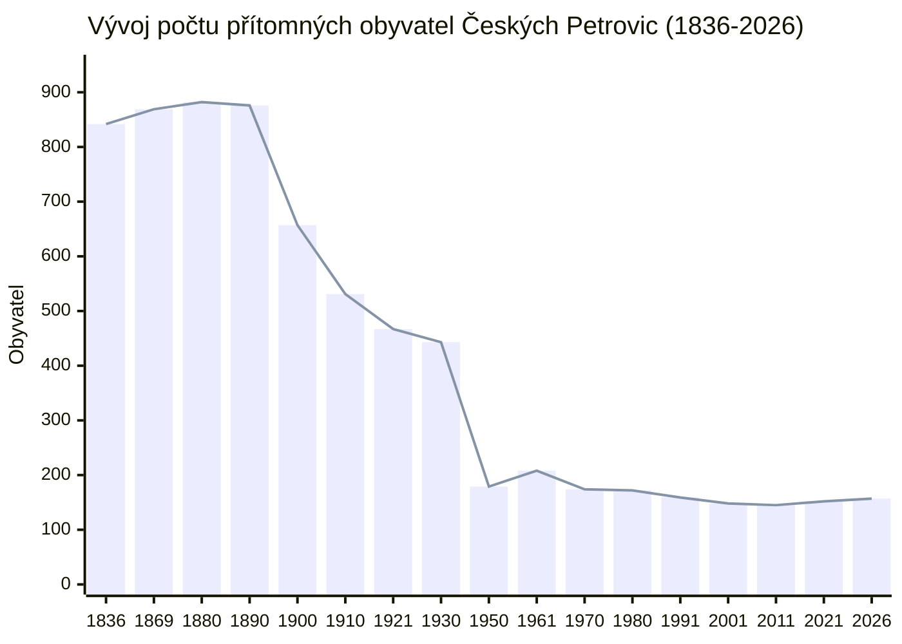

# Demografický a hospodářský vývoj Českých Petrovic (1654–2026)

Kvantitativní studie shrnuje populační, sídelní, jazykovou a agrární statistiku obce **České Petrovice** (*Böhmisch Petersdorf*, ZÚJ `580066`, k. ú. `622702`, výměra `627` ha v r. 1921 / přesně **`629,83` ha** v digitálním RÚIAN ČÚZK `[inv]`, viz [stabilni_katastr_1840.md](file:///e:/Dropbox/Antigravity/Ceske_Petrovice/docs/stabilni_katastr_1840.md)) od pobělohorského daňového soupisu (`1654`) po data Českého statistického úřadu z počátku roku `2026`. Domovní mikrohistorie všech `160` čísel popisných jsou rozpracovány v [mistopis_domu_cp1_160.md](file:///e:/Dropbox/Antigravity/Ceske_Petrovice/docs/mistopis_domu_cp1_160.md) a [domy_1771_1921.json](file:///e:/Dropbox/Antigravity/Ceske_Petrovice/data/domy_1771_1921.json).

Všechna zjištění jsou označena stupněm pramenného ověření: `[doc]` (přímé vizuální čtení primárního archivního skenu), `[ed]` (tištěná edice či úřední statistický lexikon), `[inv]` (archivní katalog), `[lit]` (sekundární literatura).

---

## 1. Dlouhodobá populační křivka a počet domů (1654–2026)

### 1.1 Grafický průběh vývoje obyvatelstva (1836–2026)

### 1.2 Souhrnná časová řada (1654–2026)

| Rok / datum | Domy | Bytové strany | Obyvatelé celkem | Jazyk / národnost (přezjištěná) | Hlavní pramen a epistemicita |
|---|---|---|---|---|---|
| **1654** | ca `56–57` usedlostí | — | — | přev. německojazyčné (pomezí) | Berní rula – kraj Hradecký (`18` sedláků, `9` malorolníků, `29–30` chalupníků) `[lit]` |
| **1836** | **153** | — | **842** | — | *Sommer, J. G., Das Königreich Böhmen IV*, s. 1836 `[ed]` |
| **1869** | — | — | **869** | — (sčítání neevidovalo obcovací řeč) | ČSÚ *Historický lexikon obcí ČR* `[ed]` (+ operáty [197cb94c](https://aron.vychodoceskearchivy.cz/apu/197cb94c-11c1-46db-958e-17538da057dc) `[doc]`) |
| **1880** | — | — | **882** | přev. německá | ČSÚ *Historický lexikon obcí ČR* `[ed]` (historické maximum) |
| **1890** | **157** | — | **876** | přev. německá | *Seznam míst v král. Českém 1893*, s. 352; ČSÚ `[ed]` |
| **1900** | **151** | — | **657** | přev. německá | *Seznam míst v král. Českém 1907*, s. 610; ČSÚ `[ed]` |
| **1910** | **148** (`137` obydl. + `11` prázdných) | **161** *(opr. ze 158)* | **531** (`238` M / `293` Ž) | **487** něm. / **41** čes. *(po opravách)* + `3` cizinci | Součtový list [scitani_1910_po_s10](file:///e:/Dropbox/Antigravity/Ceske_Petrovice/zdroje/scitani_1910_po_s10.jpg) (`inv. č. 529`) `[doc]` |
| **1921** | **143** | **145** | **467** (`221` M / `246` Ž) | **70** čs. / **391** něm. / `1` jiná + `5` cizozemců *(součet archů: `70 CS / 392 DE / 5 ciz.`)* | *Statistický lexikon 1924*, s. 92 ([sken](file:///e:/Dropbox/Antigravity/Ceske_Petrovice/zdroje/lexikon_1924_p092.jpg)) + kompletní přepis `inv. č. 970` `[doc][ed]` |
| **1930** | — | — | **443** | **67** čs. / **373** něm. *(čs. občané na mapě 1938)* | ČSÚ `[ed]` + mapa VZÚ 1938 ([výřez](file:///e:/Dropbox/Antigravity/Ceske_Petrovice/vyrezy/mapa_1938_ceske_petrovice_pomezi.jpg)) `[doc]` |
| **1949** | — | — | **196** | česká (po poválečném vysídlení) | *Seznam obcí v RČS 1949*, s. 80 `[ed]` |
| **1950** | — | — | **179** | česká | ČSÚ *Historický lexikon obcí ČR* `[ed]` |
| **1961** | — | — | **208** | česká | ČSÚ *Historický lexikon obcí ČR* `[ed]` |
| **1970** | — | — | **174** | česká | ČSÚ *Historický lexikon obcí ČR* `[ed]` |
| **1980** | — | — | **172** | česká | ČSÚ *Historický lexikon obcí ČR* `[ed]` |
| **1991** | — | — | **159** | česká | ČSÚ *Historický lexikon obcí ČR* `[ed]` |
| **2001** | — | — | **148** | česká | ČSÚ *Historický lexikon obcí ČR* `[ed]` |
| **2011** | — | — | **145** | česká | ČSÚ Sčítání lidu 2011 `[ed]` |
| **2021** | — | — | **152** | česká | ČSÚ SLDB 2021 `[ed]` |
| **2024** | — | — | **152** | česká | ČSÚ roční bilance obyvatelstva `[ed]` |
| **2026** (1. 1.) | — | — | **157** | česká | ČSÚ *Počet obyvatel v obcích k 1. 1. 2026* `[ed]` |

### 1.3 Demografické zvraty v dlouhodobém kontextu
1. **Vrchol a horská depopulace (1880–1910):** Po maximu **`882`** obyvatel v roce `1880` klesla populace během pouhých třiceti let do roku `1910` o téměř **40 %** (`-351` osob na `531` přítomných). Tento dramatický úbytek nebyl způsoben válečným konfliktem, nýbrž úpadkem tradičního horského domácího tkalcovství/přadláctví a hospodářským odchodem mladších ročníků do průmyslových center i německého Slezska (jak ilustruje konečný součet **`92`** nepřítomných domovských příslušníků v roce `1910` [`74` trvale + `18` dočasně; plně doloženo v *Hilfsausweis*, z toho `61` mimo Čechy] a svědci z Vratislavi v matrice r. 1919).
2. **Nástup českého státního aparátu a menšiny (1921):** Celkový pokles pokračoval v r. `1921` na `467` obyvatel, avšak podíl českých občanů poskočil ze `41` (`1910`, `7,8 %` rakouských občanů) na **`70`** (`1921`, `15,0 %` přítomných obyvatel ve **`26` domech** oproti `11` domům v r. `1910`) zásluhou příchodu pohraniční finanční stráže, zřízení české menšinové školy (`1920`, učitel *Josef Gruber* bytem v `čp. 160` `[doc][ed]`) a českých správců fary (`čp. 25`).
3. **Válka, vysídlení a poválečná stabilizace (1930–2026):** Po vysídlení převážné části německého obyvatelstva v letech `1945–1946` klesl počet obyvatel ze `443` (`1930`) na `179` (`1950`, pokles o **59,6 %**). Po přechodném oživení v r. `1961` (`208` obyv.) se populace ustálila mezi `145` a `159` trvalými obyvateli (`157` k `1. 1. 2026`).

---

## 2. Kritická pitva sčítání lidu a dobytka 1910 (`[doc]`)

Přímým čtením originálního součtového operátu z fondu *Okresní úřad Žamberk* (`inv. č. 529` a `607`) v plném rozlišení ([vyrezy/scitani_1910_po_s10_left.jpg](file:///e:/Dropbox/Antigravity/Ceske_Petrovice/vyrezy/scitani_1910_po_s10_left.jpg) a [right](file:///e:/Dropbox/Antigravity/Ceske_Petrovice/vyrezy/scitani_1910_po_s10_right.jpg)) byly ověřeny veškeré součtové rubriky k 31. prosinci 1910:

### 2.1 Složení obyvatelstva, domovského práva a cizozemců (`inv. č. 529`, fol. 2–3)

| Ukazatel | Hodnota (`[doc]`) | Poznámka ze sčítacího listu |
|---|---|---|
| **Domy celkem** | **148** | `137` obydlených (`bewohnt`) + `11` neobydlených (`unbewohnt`, např. `čp. 150`) |
| **Bytové strany (*Wohnparteien*)** | **161** | Původní součet `158` přeškrtnut a opraven na `161` |
| **Přítomné obyvatelstvo celkem** | **531** | `238` mužů (`44,8 %`) + `293` žen (`55,2 %`) |
| — dle pobytu | `526` trvale / `5` dočasně | `526 dauernd + 5 zeitweilig` |
| **Domovská příslušnost (občané Předlitavska)** | **528** | `437` přímo v obci + `86` v jiné obci téhož polit. okresu + `1` v jiném okr. v Čechách + `4` v jiných korunních zemích |
| **Cizí státní příslušníci (*in fremden Staaten*)** | **3** | Sousední pruské Kladsko / Německá říše apod. |
| **Náboženské vyznání** | **531** řím. kat. | `100 %` přítomného obyvatelstva římskokatolického vyznání |
| **Nepřítomní domovskí příslušníci** | **92** | Opraveno z `94` (`74` trvale + `18` dočasně nepřítomných — škrty v `čp. 62` a `čp. 86`; `100 %` shoda s *Hilfsausweis* `[doc]`) |

### 2.2 Vrstvy zásahů v rubrice „Obcovací řeč“ (*Umgangssprache*, sl. 37–38)
Zásadní archivně-kritický objev na skenu `10` ([vyrezy/scitani_1910_po_s10_right.jpg](file:///e:/Dropbox/Antigravity/Ceske_Petrovice/vyrezy/scitani_1910_po_s10_right.jpg)):
- Součet rakouských občanů ve sl. 14 činil **`528`**.
- Sčítací komisař *J. Schiel* zapsal do řádku součtů postupně **tři číselné vrstvy** (horní dvě přeškrtnuté, dolní platná inkoustem):
  1. První součet (přeškrtnut): **`491`** německy / **`37`** česky (`= 528`)
  2. Druhý součet (přeškrtnut): **`492`** německy / **`36`** česky (`= 528`)
- Konečný platný součet (neškrtnut): **`487`** německy (`92,2 %`) / **`41`** česky (`7,8 %`, `= 528`; obě přesunové opravy z první a druhé vrstvy zachyceny na `čp. 25` *Fara* `0/2 -> 1/1` a `čp. 129` *Petr Hubálek* `8/0 -> 3/5` `[doc]`).
- Celkově žilo česky mluvící obyvatelstvo v `11` domech (`čp. 11, 25, 36, 44, 85, 112, 121, 129, 145, 157, 160`), na horním konci obce konkrétně v `čp. 145` (`6` osob), `čp. 157` (`6` osob) a jazykově smíšeném `čp. 160` (`2` německy + `2` česky).

### 2.3 Struktura hospodářského zvířectva 1910 (`inv. č. 607`)

Z přehledu užitkového zvířectva ([vyrezy/scitani_1910_pz_s08_left.jpg](file:///e:/Dropbox/Antigravity/Ceske_Petrovice/vyrezy/scitani_1910_pz_s08_left.jpg) a [right](file:///e:/Dropbox/Antigravity/Ceske_Petrovice/vyrezy/scitani_1910_pz_s08_right.jpg)):

| Druh zvířectva | Celkem kusů (`[doc]`) | Podrobná struktura kategorií |
|---|---|---|
| **Koně (*Pferde*)** | **25** | `3` mladá zvířata nad 1 rok do práce, `5` klisen, `17` valachů |
| **Skot (*Rinder*)** | **272** | `20` býčků (<1 r.), `34` jaloviček (<1 r.), `4` volci (<1 r.), `10` býků (>1 r.), `15` jalovic nepřipuštěných, `26` březích jalovic, **`153` krav**, `6` tažných volů (`1–3 r.`), `4` voli k výkrmu |
| **Kozy (*Ziegen*)** | **127** | Rozšířený chov u drobných domkářů („kráva chudých“) |
| **Ovce (*Schafe*)** | **0** | V obci r. `1910` bez chovu ovcí |
| **Prasata (*Schweine*)** | **167** *(skutečně `170`)* | `68` selat (do 3 měs.), `87` běhounů (do 1 r.), `9` chovných prasnic, `3` ostatní *(sčítací písař se spletl o `-3`)* |
| **Včelstva (*Bienenstöcke*)** | **3** | Všechny v úlech nerozběrných (`unbeweglicher Bau`) |
| **Drůbež (*Geflügel*)** | **797** *(skutečně `803`)* | `701` zapsaných slepic (`704` dle řádků), `5` hus, `91` zapsané ostatní drůbeže (`94` dle řádků; celkem `162` řádků `[doc]`) |

---

## 3. Sčítání 1921: korekce OCR a mikrohistorické sondy (`[doc][ed]`)

### 3.1 Křížová korekce *Statistického lexikonu 1924*
Automatické OCR z MZK Kramerius zkreslilo řádek 15 (`Petrovice, České`) na s. 92 (*142* domů, *10* Čechoslováků). Přímé přečtení IIIF originálu [zdroje/lexikon_1924_p092.jpg](file:///e:/Dropbox/Antigravity/Ceske_Petrovice/zdroje/lexikon_1924_p092.jpg) prokazuje:
- **Výměra:** `627` ha; **Domy:** `143`; **Bytové strany:** `145`.
- **Přítomné obyvatelstvo:** `467` (`221` mužů, `246` žen).
- **Národnost čs. občanů:** **`70` československá**, **`391` německá**, **`1` jiná** + **`5` cizozemců** (`70 + 391 + 1 + 5 = 467`).
- **Vyznání:** `460` římskokatolické, `3` evangelické, `4` bez vyznání (`460 + 3 + 4 = 467`).

### 3.2 Vybrané domy ze sčítacích archů z února 1921 (`OÚ Žamberk, inv. č. 970`, `[doc]`)

| Čp. (snímek) | Majitel / obyvatelé | Národnost a vyznání | Povolání a poznámky ze sčítání |
|---|---|---|---|
| **`čp. 1`** (`s001`) | *Umlaufová Marie* (maj.), *Umlaufová Emilie*, *Schreiberová Vilemína*, *Toman Jaroslav* (`Pastvorová? Marie`) | přev. německá, ŘK | Kontinuita se sčítáním `1869` (rod *Umlauf* v `čp. 1`) |
| **`čp. 7`** (`s013`) | **Koth Josef** (`*2. 6. 1892`), manželka **Kothová Emilie** roz. Krause (`*13. 6. 1890`) | oba německá, ŘK | Josef Koth v r. 1914 *klempíř*, v r. 1921 samostatný *zemědělec*; mladí novomanželé (oddáni `10. 6. 1919`) po převzetí usedlosti nevěstiny rodiny ([výřez](file:///e:/Dropbox/Antigravity/Ceske_Petrovice/vyrezy/scitani_1921_koth_left.jpg)) |
| **`čp. 25`** (`s049`) | **Chládek František** (`*29. 5. 1864`, nar. Rychnov n. Kn., majitel: Fara) | **česká**, ŘK | Katolický farář v Českých Petrovicích ([sken](file:///e:/Dropbox/Antigravity/Ceske_Petrovice/zdroje/scitani_1921_cp25_fara.jpg)) |
| **`čp. 27`** (`s051`) | **Matiasko Otto** (`*2. 8. 1889` Kohoutov, doč. správce školy) s manž. Annou a dcerami; podnájemník **Malisch Bruno** (učitel, nar. Hranice na Mor.) | německá (`4`), ŘK | Budova **německé obecné školy** ([sken](file:///e:/Dropbox/Antigravity/Ceske_Petrovice/zdroje/scitani_1921_cp27_skola.jpg)) |
| **`čp. 160`** (`s285`) | Majitelka domu *Kalousová Marie* / bytu vdova *Kalousová Emilie* (`*22. 8. 1866`, něm., ŘK); podnájemníci **Pavel Josef** s manž. **Marií** (čsl., ev. ref.), **Šlesinger František**, **Štehover Rudolf**, **Prchlík Bohuslav**, **Gruber Josef** (`*2. 2. 1894`, Luže) | 1 něm. / **6 českých** (4 bez vyzn., 1 ev. ref., 1 ŘK) | Dočasné ubytování sboru čs. **Pohraniční finanční stráže** (`čp. 36` státní kasárna v převodu) a učitele menšinové jednotřídky (`od r. 1920` `[ed]`) **Josefa Grubera**, jenž byl zároveň **sčítacím komisařem** celé obce ([výřez](file:///e:/Dropbox/Antigravity/Ceske_Petrovice/vyrezy/scitani_1921_cp160_straz_left.jpg)) |

---

## 4. Mikroregionální srovnání pomezí podle mapy VZÚ 1938 (`[doc]`)

Speciální mapa *Žamberk [4056]* (VZÚ Praha `1938`, [vyrezy/mapa_1938_ceske_petrovice_pomezi.jpg](file:///e:/Dropbox/Antigravity/Ceske_Petrovice/vyrezy/mapa_1938_ceske_petrovice_pomezi.jpg)) zachycuje národnostní rozhraní bezprostředně přiléhajících sídel dle dat z r. 1930:

| Sídlo na mapě VZÚ 1938 | Československá národnost (`č`) | Německá národnost (`n`) | Podíl českého obyvatelstva |
|---|---|---|---|
| **Petrovice Č. (*Bhm. Petersdf.*)** | **67** | **373** | `15,2 %` *(ze součtu č+n = 440; s cizinci 443)* |
| **Něm. Petrovice (*Petrovičky*)** | `15` | `161` | `8,5 %` |
| **Mladkov (*Wichstadtl*)** | `129` | `582` | `18,1 %` |
| **Ostrov (*Nesselfleck*)** | `0` | `23` | `0 %` |
| **Jedlina** | `92` | `0` | `100 %` *(horská česká osada v týlu Klášterce)* |
| **Klášterec n. Orl.** | `789` | `6` | `99,2 %` *(ostrá jazyková hranice pod Čihákem)* |
